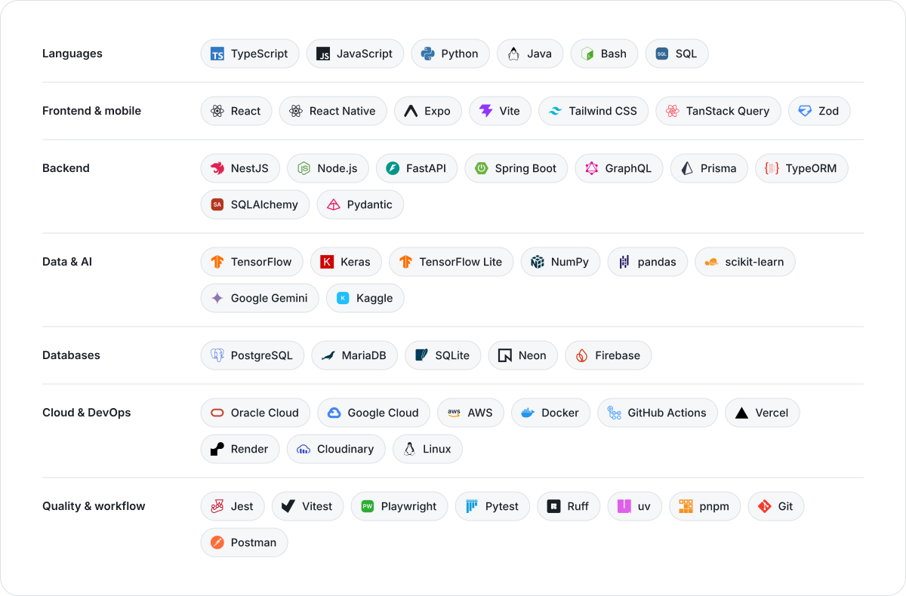
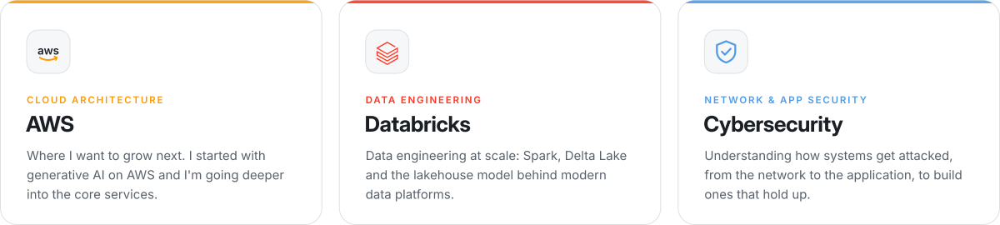
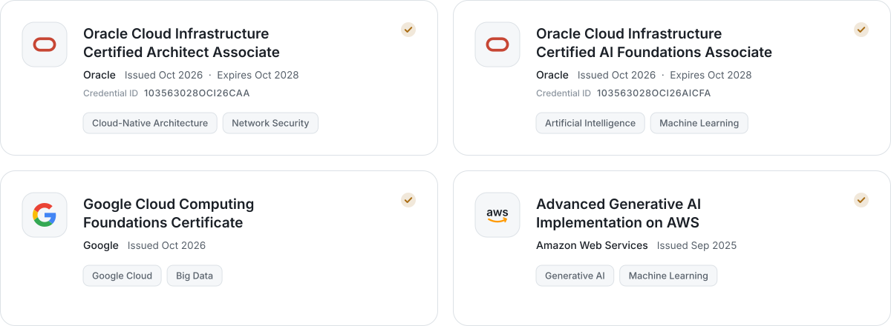

<picture>
  <source media="(prefers-color-scheme: dark)" srcset="assets/header-dark.svg">
  
</picture>

  <a href="mailto:keylorpineda729@gmail.com">
    <picture>
      <source media="(prefers-color-scheme: dark)" srcset="assets/btn-email-dark.svg">
      
    </picture>
  </a>
  &nbsp;
  <a href="https://www.linkedin.com/in/keylorpineda">
    <picture>
      <source media="(prefers-color-scheme: dark)" srcset="assets/btn-linkedin-dark.svg">
      
    </picture>
  </a>

 

## About me

I'm Keylor, a software developer from Costa Rica. I like building complete products: the database, the API, the interface, and the tests and CI that keep it all working.

Right now most of my time goes into HealthyCropping, an Android app that recognizes coffee diseases from a photo without an internet connection. Before that I built Booth, a catalog and ordering tool for small shops that sell through WhatsApp, and a RAG engine that answers questions using only the documents you give it.

Outside of the code I'm studying cloud and security, and the certifications below come from that.

 

## Selected work

<a href="https://github.com/keylorpineda/healthycropping">
  <picture>
    <source media="(prefers-color-scheme: dark)" srcset="assets/project-healthycropping-dark.svg">
    
  </picture>
</a>

<a href="https://github.com/keylorpineda/booth">
  <picture>
    <source media="(prefers-color-scheme: dark)" srcset="assets/project-booth-dark.svg">
    
  </picture>
</a>

<a href="https://booth-tawny.vercel.app/s/panaderia-demo">Open the demo store</a> &nbsp;·&nbsp; <a href="https://github.com/keylorpineda/booth">Source</a>

<a href="https://github.com/keylorpineda/RAG-Research-Engine">
  <picture>
    <source media="(prefers-color-scheme: dark)" srcset="assets/project-rag-dark.svg">
    
  </picture>
</a>

<a href="https://github.com/keylorpineda/doomsday-system-api">
  <picture>
    <source media="(prefers-color-scheme: dark)" srcset="assets/project-doomsday-dark.svg">
    
  </picture>
</a>

<a href="https://github.com/keylorpineda/doomsday-system-api">API</a> &nbsp;·&nbsp; <a href="https://github.com/keylorpineda/doomsday-system-ui">Dashboard</a> &nbsp;·&nbsp; <a href="https://doomsday-system-api.onrender.com/api/v1">Live API</a>

<b>A few more things I've built</b>

 

| Project | What it does | Stack |
| :-- | :-- | :-- |
| [Non-Profit Intel Scraper](https://github.com/keylorpineda/nonprofit_intel_scraper) | Scrapes nonprofit directories, enriches them with IRS 990 data and has Gemini score which ones are worth a sales call, and why. | Python, Playwright, Gemini, Pydantic |
| [HealthyHabits API](https://github.com/keylorpineda/HealthyHabits-API) | GraphQL API for routines, habits and progress tracking with JWT auth and role based permissions. | Java 21, Spring Boot, GraphQL, MariaDB |

 

## Toolbox

<picture>
  <source media="(prefers-color-scheme: dark)" srcset="assets/toolbox-dark.svg">
  
</picture>

 

## Where I'm heading

<picture>
  <source media="(prefers-color-scheme: dark)" srcset="assets/interests-dark.svg">
  
</picture>

 

## Certifications

<a href="https://www.linkedin.com/in/keylorpineda/details/certifications/">
  <picture>
    <source media="(prefers-color-scheme: dark)" srcset="assets/certifications-dark.svg">
    
  </picture>
</a>

 

## Activity

<picture>
  <source media="(prefers-color-scheme: dark)" srcset="https://raw.githubusercontent.com/keylorpineda/keylorpineda/output/activity-dark.svg">
  
</picture>

<picture>
  <source media="(prefers-color-scheme: dark)" srcset="https://raw.githubusercontent.com/keylorpineda/keylorpineda/output/snake-dark.svg">
  
</picture>

 

## Contact

Email me at [keylorpineda729@gmail.com](mailto:keylorpineda729@gmail.com) or find me on [LinkedIn](https://www.linkedin.com/in/keylorpineda).
