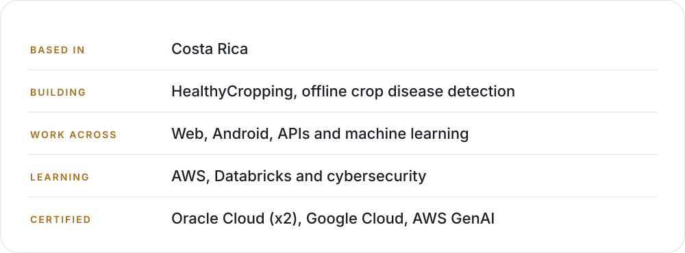
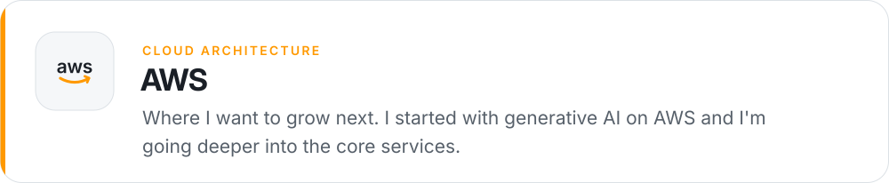
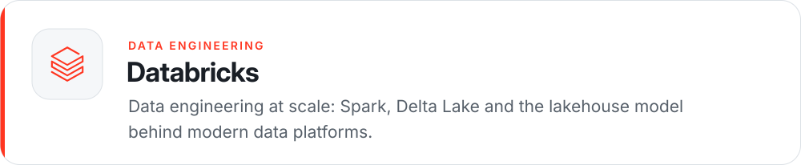
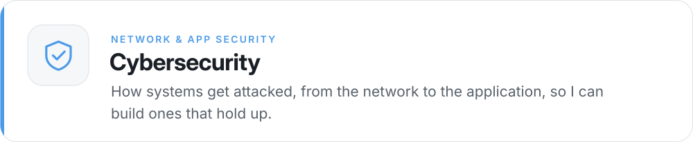
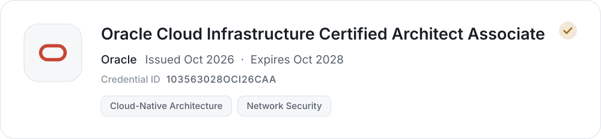
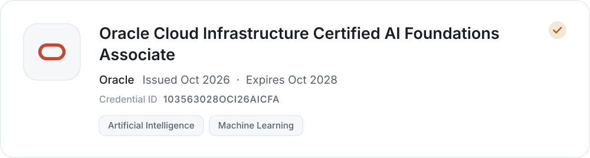
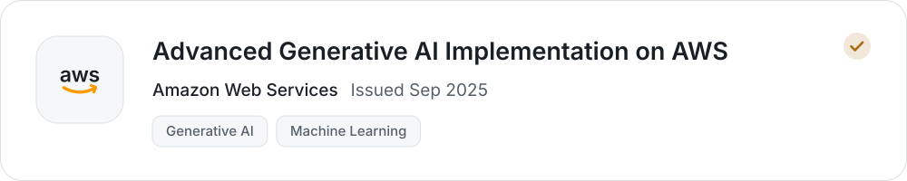
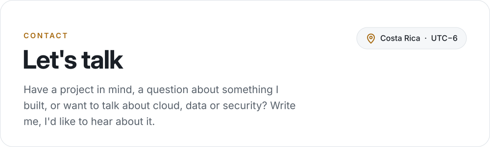
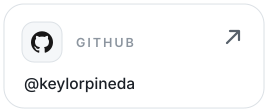

<picture><source media="(prefers-color-scheme: dark)" srcset="assets/header-dark.svg"></picture>

  <a href="mailto:keylorpineda729@gmail.com"><picture><source media="(prefers-color-scheme: dark)" srcset="assets/btn-email-dark.svg"></picture></a>
  <a href="https://www.linkedin.com/in/keylor-pineda"><picture><source media="(prefers-color-scheme: dark)" srcset="assets/btn-linkedin-dark.svg"></picture></a>
  <a href="https://github.com/keylorpineda?tab=repositories"><picture><source media="(prefers-color-scheme: dark)" srcset="assets/btn-repos-dark.svg"></picture></a>

## About me

I'm Keylor, a software developer from Costa Rica. I like building complete products: the database, the API, the interface, and the tests and CI that keep everything working.

Right now most of my time goes into **HealthyCropping**, an Android app that recognizes coffee diseases from a photo without an internet connection. Before that I built **Booth**, a catalog and ordering tool for small shops that sell through WhatsApp, and a **RAG engine** that answers questions using only the documents you give it.

Outside of the code I'm studying cloud and security, which is where the certifications below come from.

<picture><source media="(prefers-color-scheme: dark)" srcset="assets/about-dark.svg"></picture>

## Selected work

<a href="https://github.com/keylorpineda/healthycropping"><picture><source media="(prefers-color-scheme: dark)" srcset="assets/project-healthycropping-dark.svg"></picture></a>

Point a phone at a coffee leaf and get a diagnosis right there in the plot. A MobileNetV3 model trained on public coffee datasets runs on the device through TensorFlow Lite, and scans, farms and plots are stored locally first. Cacao and banana models come next, along with a Gemini RAG layer that explains what to do and cites official agronomy manuals.

<picture><source media="(prefers-color-scheme: dark)" srcset="assets/chips/reactnative-dark.svg"></picture>
<picture><source media="(prefers-color-scheme: dark)" srcset="assets/chips/expo-dark.svg"></picture>
<picture><source media="(prefers-color-scheme: dark)" srcset="assets/chips/typescript-dark.svg"></picture>
<picture><source media="(prefers-color-scheme: dark)" srcset="assets/chips/tflite-dark.svg"></picture>
<picture><source media="(prefers-color-scheme: dark)" srcset="assets/chips/python-dark.svg"></picture>
<picture><source media="(prefers-color-scheme: dark)" srcset="assets/chips/fastapi-dark.svg"></picture>
<picture><source media="(prefers-color-scheme: dark)" srcset="assets/chips/firebase-dark.svg"></picture>
<picture><source media="(prefers-color-scheme: dark)" srcset="assets/chips/sqlite-dark.svg"></picture>
<picture><source media="(prefers-color-scheme: dark)" srcset="assets/chips/googlegemini-dark.svg"></picture>

<a href="https://github.com/keylorpineda/healthycropping"><picture><source media="(prefers-color-scheme: dark)" srcset="assets/btn-source-dark.svg"></picture></a>

 

<a href="https://github.com/keylorpineda/booth"><picture><source media="(prefers-color-scheme: dark)" srcset="assets/project-booth-dark.svg"></picture></a>

Small businesses already sell through WhatsApp, one chat at a time. Booth gives each store a single link with its catalog, turns the cart into a clean WhatsApp message, reserves stock atomically and uses Gemini to read transfer receipts, so owners know what to check before confirming a payment.

<picture><source media="(prefers-color-scheme: dark)" srcset="assets/chips/react-dark.svg"></picture>
<picture><source media="(prefers-color-scheme: dark)" srcset="assets/chips/typescript-dark.svg"></picture>
<picture><source media="(prefers-color-scheme: dark)" srcset="assets/chips/vite-dark.svg"></picture>
<picture><source media="(prefers-color-scheme: dark)" srcset="assets/chips/tailwindcss-dark.svg"></picture>
<picture><source media="(prefers-color-scheme: dark)" srcset="assets/chips/reactquery-dark.svg"></picture>
<picture><source media="(prefers-color-scheme: dark)" srcset="assets/chips/nestjs-dark.svg"></picture>
<picture><source media="(prefers-color-scheme: dark)" srcset="assets/chips/prisma-dark.svg"></picture>
<picture><source media="(prefers-color-scheme: dark)" srcset="assets/chips/postgresql-dark.svg"></picture>
<picture><source media="(prefers-color-scheme: dark)" srcset="assets/chips/zod-dark.svg"></picture>
<picture><source media="(prefers-color-scheme: dark)" srcset="assets/chips/googlegemini-dark.svg"></picture>
<picture><source media="(prefers-color-scheme: dark)" srcset="assets/chips/vercel-dark.svg"></picture>
<picture><source media="(prefers-color-scheme: dark)" srcset="assets/chips/render-dark.svg"></picture>
<picture><source media="(prefers-color-scheme: dark)" srcset="assets/chips/neon-dark.svg"></picture>
<picture><source media="(prefers-color-scheme: dark)" srcset="assets/chips/playwright-dark.svg"></picture>

<a href="https://booth-tawny.vercel.app/s/panaderia-demo"><picture><source media="(prefers-color-scheme: dark)" srcset="assets/btn-demo-dark.svg"></picture></a>
<a href="https://github.com/keylorpineda/booth"><picture><source media="(prefers-color-scheme: dark)" srcset="assets/btn-source-dark.svg"></picture></a>

 

<a href="https://github.com/keylorpineda/RAG-Research-Engine"><picture><source media="(prefers-color-scheme: dark)" srcset="assets/project-rag-dark.svg"></picture></a>

Upload documents, ask in any language and get answers based only on what you uploaded. When the context doesn't hold the answer, it says so instead of making one up. Retrieval favors more recent files, the context is capped at 4,000 tokens, and every answer shows the passages it came from.

<picture><source media="(prefers-color-scheme: dark)" srcset="assets/chips/python-dark.svg"></picture>
<picture><source media="(prefers-color-scheme: dark)" srcset="assets/chips/fastapi-dark.svg"></picture>
<picture><source media="(prefers-color-scheme: dark)" srcset="assets/chips/postgresql-dark.svg"></picture>
<picture><source media="(prefers-color-scheme: dark)" srcset="assets/chips/sqlalchemy-dark.svg"></picture>
<picture><source media="(prefers-color-scheme: dark)" srcset="assets/chips/cohere-dark.svg"></picture>
<picture><source media="(prefers-color-scheme: dark)" srcset="assets/chips/groq-dark.svg"></picture>
<picture><source media="(prefers-color-scheme: dark)" srcset="assets/chips/meta-dark.svg"></picture>
<picture><source media="(prefers-color-scheme: dark)" srcset="assets/chips/docker-dark.svg"></picture>

<a href="https://github.com/keylorpineda/RAG-Research-Engine"><picture><source media="(prefers-color-scheme: dark)" srcset="assets/btn-source-dark.svg"></picture></a>

 

## Toolbox

**Languages**

<picture><source media="(prefers-color-scheme: dark)" srcset="assets/chips/typescript-dark.svg"></picture>
<picture><source media="(prefers-color-scheme: dark)" srcset="assets/chips/javascript-dark.svg"></picture>
<picture><source media="(prefers-color-scheme: dark)" srcset="assets/chips/python-dark.svg"></picture>
<picture><source media="(prefers-color-scheme: dark)" srcset="assets/chips/java-dark.svg"></picture>
<picture><source media="(prefers-color-scheme: dark)" srcset="assets/chips/gnubash-dark.svg"></picture>
<picture><source media="(prefers-color-scheme: dark)" srcset="assets/chips/sql-dark.svg"></picture>

**Frontend & mobile**

<picture><source media="(prefers-color-scheme: dark)" srcset="assets/chips/react-dark.svg"></picture>
<picture><source media="(prefers-color-scheme: dark)" srcset="assets/chips/reactnative-dark.svg"></picture>
<picture><source media="(prefers-color-scheme: dark)" srcset="assets/chips/expo-dark.svg"></picture>
<picture><source media="(prefers-color-scheme: dark)" srcset="assets/chips/vite-dark.svg"></picture>
<picture><source media="(prefers-color-scheme: dark)" srcset="assets/chips/tailwindcss-dark.svg"></picture>
<picture><source media="(prefers-color-scheme: dark)" srcset="assets/chips/reactquery-dark.svg"></picture>
<picture><source media="(prefers-color-scheme: dark)" srcset="assets/chips/zod-dark.svg"></picture>

**Backend**

<picture><source media="(prefers-color-scheme: dark)" srcset="assets/chips/nestjs-dark.svg"></picture>
<picture><source media="(prefers-color-scheme: dark)" srcset="assets/chips/nodedotjs-dark.svg"></picture>
<picture><source media="(prefers-color-scheme: dark)" srcset="assets/chips/fastapi-dark.svg"></picture>
<picture><source media="(prefers-color-scheme: dark)" srcset="assets/chips/springboot-dark.svg"></picture>
<picture><source media="(prefers-color-scheme: dark)" srcset="assets/chips/graphql-dark.svg"></picture>
<picture><source media="(prefers-color-scheme: dark)" srcset="assets/chips/prisma-dark.svg"></picture>
<picture><source media="(prefers-color-scheme: dark)" srcset="assets/chips/typeorm-dark.svg"></picture>
<picture><source media="(prefers-color-scheme: dark)" srcset="assets/chips/sqlalchemy-dark.svg"></picture>
<picture><source media="(prefers-color-scheme: dark)" srcset="assets/chips/pydantic-dark.svg"></picture>

**Data & AI**

<picture><source media="(prefers-color-scheme: dark)" srcset="assets/chips/tensorflow-dark.svg"></picture>
<picture><source media="(prefers-color-scheme: dark)" srcset="assets/chips/keras-dark.svg"></picture>
<picture><source media="(prefers-color-scheme: dark)" srcset="assets/chips/tflite-dark.svg"></picture>
<picture><source media="(prefers-color-scheme: dark)" srcset="assets/chips/numpy-dark.svg"></picture>
<picture><source media="(prefers-color-scheme: dark)" srcset="assets/chips/pandas-dark.svg"></picture>
<picture><source media="(prefers-color-scheme: dark)" srcset="assets/chips/scikitlearn-dark.svg"></picture>
<picture><source media="(prefers-color-scheme: dark)" srcset="assets/chips/googlegemini-dark.svg"></picture>
<picture><source media="(prefers-color-scheme: dark)" srcset="assets/chips/kaggle-dark.svg"></picture>

**Databases**

<picture><source media="(prefers-color-scheme: dark)" srcset="assets/chips/postgresql-dark.svg"></picture>
<picture><source media="(prefers-color-scheme: dark)" srcset="assets/chips/mariadb-dark.svg"></picture>
<picture><source media="(prefers-color-scheme: dark)" srcset="assets/chips/sqlite-dark.svg"></picture>
<picture><source media="(prefers-color-scheme: dark)" srcset="assets/chips/neon-dark.svg"></picture>
<picture><source media="(prefers-color-scheme: dark)" srcset="assets/chips/firebase-dark.svg"></picture>

**Cloud & DevOps**

<picture><source media="(prefers-color-scheme: dark)" srcset="assets/chips/oracle-dark.svg"></picture>
<picture><source media="(prefers-color-scheme: dark)" srcset="assets/chips/googlecloud-dark.svg"></picture>
<picture><source media="(prefers-color-scheme: dark)" srcset="assets/chips/aws-dark.svg"></picture>
<picture><source media="(prefers-color-scheme: dark)" srcset="assets/chips/docker-dark.svg"></picture>
<picture><source media="(prefers-color-scheme: dark)" srcset="assets/chips/githubactions-dark.svg"></picture>
<picture><source media="(prefers-color-scheme: dark)" srcset="assets/chips/vercel-dark.svg"></picture>
<picture><source media="(prefers-color-scheme: dark)" srcset="assets/chips/render-dark.svg"></picture>
<picture><source media="(prefers-color-scheme: dark)" srcset="assets/chips/cloudinary-dark.svg"></picture>
<picture><source media="(prefers-color-scheme: dark)" srcset="assets/chips/linux-dark.svg"></picture>

**Quality & workflow**

<picture><source media="(prefers-color-scheme: dark)" srcset="assets/chips/jest-dark.svg"></picture>
<picture><source media="(prefers-color-scheme: dark)" srcset="assets/chips/vitest-dark.svg"></picture>
<picture><source media="(prefers-color-scheme: dark)" srcset="assets/chips/playwright-dark.svg"></picture>
<picture><source media="(prefers-color-scheme: dark)" srcset="assets/chips/pytest-dark.svg"></picture>
<picture><source media="(prefers-color-scheme: dark)" srcset="assets/chips/ruff-dark.svg"></picture>
<picture><source media="(prefers-color-scheme: dark)" srcset="assets/chips/uv-dark.svg"></picture>
<picture><source media="(prefers-color-scheme: dark)" srcset="assets/chips/pnpm-dark.svg"></picture>
<picture><source media="(prefers-color-scheme: dark)" srcset="assets/chips/git-dark.svg"></picture>
<picture><source media="(prefers-color-scheme: dark)" srcset="assets/chips/postman-dark.svg"></picture>

## Where I'm heading

<picture><source media="(prefers-color-scheme: dark)" srcset="assets/interest-aws-dark.svg"></picture>

<picture><source media="(prefers-color-scheme: dark)" srcset="assets/interest-databricks-dark.svg"></picture>

<picture><source media="(prefers-color-scheme: dark)" srcset="assets/interest-shield-dark.svg"></picture>

## Certifications

<a href="https://www.linkedin.com/in/keylor-pineda/details/certifications/"><picture><source media="(prefers-color-scheme: dark)" srcset="assets/cert-oci-architect-dark.svg"></picture></a>

<a href="https://www.linkedin.com/in/keylor-pineda/details/certifications/"><picture><source media="(prefers-color-scheme: dark)" srcset="assets/cert-oci-ai-dark.svg"></picture></a>

<a href="https://www.linkedin.com/in/keylor-pineda/details/certifications/"><picture><source media="(prefers-color-scheme: dark)" srcset="assets/cert-gcp-dark.svg"></picture></a>

<a href="https://www.linkedin.com/in/keylor-pineda/details/certifications/"><picture><source media="(prefers-color-scheme: dark)" srcset="assets/cert-aws-dark.svg"></picture></a>

## Activity

Pulled from the GitHub API and refreshed every day.

<picture><source media="(prefers-color-scheme: dark)" srcset="https://raw.githubusercontent.com/keylorpineda/keylorpineda/output/activity-stats-dark.svg"></picture>

<picture><source media="(prefers-color-scheme: dark)" srcset="https://raw.githubusercontent.com/keylorpineda/keylorpineda/output/activity-calendar-dark.svg"></picture>

<picture><source media="(prefers-color-scheme: dark)" srcset="https://raw.githubusercontent.com/keylorpineda/keylorpineda/output/activity-months-dark.svg"></picture>

<picture><source media="(prefers-color-scheme: dark)" srcset="https://raw.githubusercontent.com/keylorpineda/keylorpineda/output/activity-breakdown-dark.svg"></picture>

<picture><source media="(prefers-color-scheme: dark)" srcset="https://raw.githubusercontent.com/keylorpineda/keylorpineda/output/activity-repos-dark.svg"></picture>

<picture><source media="(prefers-color-scheme: dark)" srcset="https://raw.githubusercontent.com/keylorpineda/keylorpineda/output/activity-languages-dark.svg"></picture>

## Contact

<a href="mailto:keylorpineda729@gmail.com"><picture><source media="(prefers-color-scheme: dark)" srcset="assets/contact-dark.svg"></picture></a>

  <a href="mailto:keylorpineda729@gmail.com"><picture><source media="(prefers-color-scheme: dark)" srcset="assets/contact-email-dark.svg"></picture></a>
  <a href="https://www.linkedin.com/in/keylor-pineda"><picture><source media="(prefers-color-scheme: dark)" srcset="assets/contact-linkedin-dark.svg"></picture></a>
  <a href="https://github.com/keylorpineda"><picture><source media="(prefers-color-scheme: dark)" srcset="assets/contact-github-dark.svg"></picture></a>

Thanks for stopping by.

